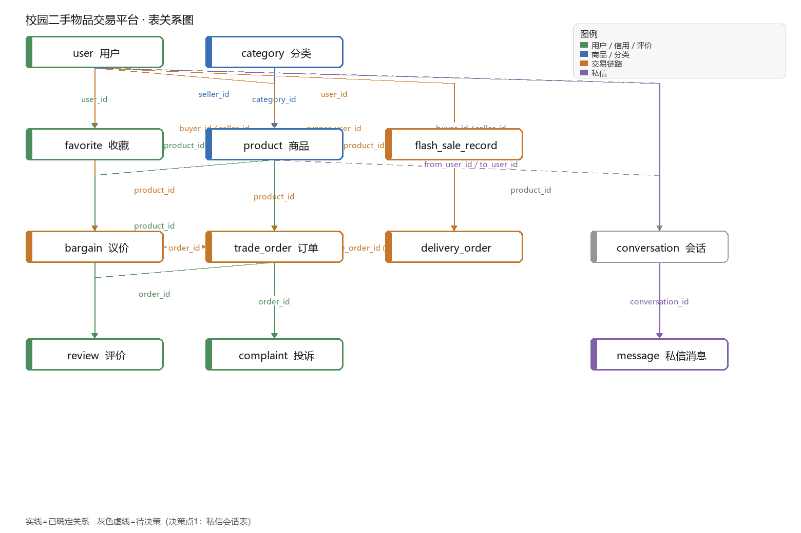

# 校园二手交易平台

> 基于 Spring Boot 的校园二手交易系统。覆盖「发布 → 议价 → 下单 → 支付 → 跑腿 → 收货 → 评价 → 投诉」完整链路，
> 含**管理端数据看板**与**用户端 H5** 两套前端（零构建，纯 HTML + 原生 JS）。

<p align="center">
  
</p>

## 目录

- [功能概览](#功能概览)
- [技术栈](#技术栈)
- [技术亮点](#技术亮点)
- [项目结构](#项目结构)
- [快速开始](#快速开始)
- [测试](#测试)
- [文档](#文档)

---

## 功能概览

| 模块 | 说明 |
|---|---|
| **商品** | 发布 / 编辑 / 上下架 / 审核 / 分类筛选 / 搜索 / 浏览量 / 收藏 |
| **订单** | 下单 → 卖家确认 → 支付 → 卖家发货 → 买家收货 → 完成；超时自动关单 |
| **议价** | 买家出价 / 卖家还价 / 接受 / 拒绝；单轮制 + 24 小时过期；成交直接生成订单 |
| **限时捡漏** | Redis Lua 预扣库存 + 数据库兜底 + 唯一索引三层防线；取消订单自动归还库存 |
| **私信** | 会话复用（同一商品同一买卖双方只建一个）/ 聊天记录 / 未读红点 / WebSocket 实时推送（含已读回执）|
| **校园跑腿** | 按距离档位计费并在下单时快照；跑腿大厅抢单；取货 → 送达状态机；主订单取消联动 |
| **评价与信用分** | 一单一评；好评 +1 / 差评 -2 / 成交 +2；**每日加分上限 10 分**；补偿性加分豁免上限 |
| **投诉工单** | 商品举报 / 交易纠纷 / 管理端裁决；成立扣 10 分且**只扣一次**（幂等）|
| **管理端** | 数据看板（13 个指标）/ 商品审核 / 订单管理 / 用户封禁 / 跑腿单管理 / 评价管理 / 热门品类榜 |
| **用户主页** | 查看他人的信用分、好评差评数、在售与已售数量、收到的评价（**不暴露任何隐私字段**）|

## 技术栈

| 层 | 选型 |
|---|---|
| 框架 | Spring Boot 2.7 / Spring MVC / MyBatis |
| 数据库 | MySQL 8 + Druid 连接池；15 张表 |
| 缓存 | Redis（Lettuce）；Lua 脚本做原子库存扣减 |
| 实时通信 | WebSocket（`/ws/{sid}`，用 JWT 做连接鉴权）|
| 鉴权 | JWT 双令牌：管理端 `token` / 用户端 `authentication`，由拦截器统一校验 |
| 文档 | knife4j（Swagger）→ `/doc.html` |
| 前端 | 原生 HTML + JS + 手写设计系统（**零构建**，见下方说明）|
| 构建 | Maven 多模块（`campus-common` / `campus-pojo` / `campus-server`）|

## 技术亮点

### 1. 并发控制一律用「条件更新 + 影响行数判断」，不用 `select for update`

抢单、接单、退款、状态流转，全部是这一种写法：

```sql
update trade_order set status = 2, finish_time = now()
where id = ? and status = 1
```

```java
int rows = mapper.updateStatusIfMatch(id, 1, 2);
if (rows == 0) throw new BaseException("订单状态已变化");
```

**为什么**：单行 `UPDATE` 本身就是原子的，命中索引时只锁一行，
比悲观锁少一次 RTT、也不会因为忘记释放锁而死锁。
在 8 个跑腿员并发抢同一单的压测里，恰好 1 个成功。

### 2. 限时捡漏的三层防线

```
① Redis Lua 预扣库存    —— 挡住 99% 的流量，原子操作不超卖
② 数据库乐观扣减         —— Redis 挂了也能扛（stock > 0 才扣）
③ 唯一索引 (user_id, product_id) —— 最后兜底，防同一个人抢到两件
```

失败时的补偿方向经过仔细推敲：**宁可 Redis 库存偏高，也不能偏低**
—— 偏高只是多来几个请求被数据库挡住，偏低会造成"明明有货却抢不到"。

### 3. 信用分的「每日上限」与「补偿豁免」

- **每日加分上限 10 分**：防止刷分
- **扣分不受上限限制**：否则恶意用户等于"每天最多被扣 10 分"
- **补偿性加分豁免上限**：管理员撤销违规差评要把分还回去，不属于刷分
- **总分下限 0**：扣到底不会变负数

`changeCredit()` 有两个重载，6 参数版本多了 `countTowardDailyCap` 开关，就是为这件事。

### 4. 热门品类榜：把「热度分」抽成静态纯函数

单件二手商品最多成交一次，所以"成交量"恒为 0/1，没有区分度。
改成两级榜：**分类聚合**（成交量 × 10 + 在售量）+ **分类内单品按热度分排序**。

```
热度分 = 卖出(50) + 售出耗时(30) + 收藏(20)
        · 卖出：已成交 50 分，否则 0 —— 自然形成"卖过 / 没卖过"两个梯队
        · 耗时：DATEDIFF(结束时刻, 起算时刻)，90 天封顶（最低 0 分，不会变负）
        · 收藏：20 个封顶 —— 收藏能刷，不封顶就能刷上榜
```

耗时统计有个细节：**捡漏商品从开抢时刻（`flash_start_time`）起算，不是从发布时刻**。
另外「上架时间」单独用 `online_time` 记录，不能用 `create_time` ——
否则商品被自动下架后重新上架，第二天又会被扫下架，功能直接废掉。

打分逻辑抽成 `public static double calcHotScore(...)`，配 **14 个单元用例**
覆盖 null、封顶、满分等边界 —— 它抓出过两个真实 bug：`Integer` 拆箱 NPE、算了分忘了 return。

### 5. 零构建前端（受环境限制的主动选择）

开发机无法联网安装 npm 包，所以放弃 Vue/React，改用**原生 JS + 手写设计系统**：

- `common.css`：一套 CSS 变量 + 组件样式（卡片 / 胶囊 / 抽屉 / 环形图）
- `common.js`：`api()` 封装、鉴权、toast、modal、22 个内联 SVG 图标
- 两端共约 1300 行，覆盖 H5 全流程 + 管理端 7 个模块

**好处**：改一行刷新即见效、部署零依赖；**代价**：没有组件化和状态管理。
这个取舍写在这里，是因为**"在限制下做选择"本身也是工程能力**。

## 项目结构

```
campus-second-hand
├── campus-common        通用层：常量、异常、工具、JWT
├── campus-pojo          实体 / DTO / VO
├── campus-server        业务层
│   ├── controller       管理端 / 用户端接口
│   ├── service          业务逻辑
│   ├── mapper + xml     MyBatis 映射
│   ├── config           拦截器、WebSocket、knife4j、静态资源
│   └── static/ui        两套前端（admin / user）
├── sql/                 建表脚本 + 测试数据重置脚本
├── docs/                设计文档、接口文档、面试材料
└── tools/               209 项回归测试 + 演示数据生成器
```

## 快速开始

```bash
# 1. 建库导表
mysql -uroot -p -e "create database campus_second_hand default charset utf8mb4"
mysql -uroot -p campus_second_hand < sql/schema.sql

# 2. 配置（数据库密码 / Redis）
cp campus-server/src/main/resources/application-dev.yml.example \
   campus-server/src/main/resources/application-dev.yml
# 编辑 application-dev.yml

# 3. 打包运行
mvn -pl campus-server -am -DskipTests package
java -jar campus-server/target/campus-server-1.0-SNAPSHOT.jar
```

| 地址 | 说明 |
|---|---|
| http://localhost:8080/ui/index.html | 着陆页（三个入口）|
| http://localhost:8080/ui/user/index.html | 用户端 H5（点页面上的快捷登录，免密码）|
| http://localhost:8080/ui/admin/index.html | 管理端（`zhangsan` / `123456`）|
| http://localhost:8080/doc.html | 接口文档（knife4j）|

**演示数据**：`powershell -ExecutionPolicy Bypass -File tools/reseed-demo.ps1`
会灌入 37 个用户 / 51 件商品 / 38 笔订单 / 评价 / 投诉 / 收藏，打开就像系统在跑。

## 测试

```powershell
powershell -ExecutionPolicy Bypass -File tools/run-regression.ps1
```

**209 项断言，覆盖 10 个业务模块，一条命令，约 5 分钟：**

| 模块 | 项数 | 重点覆盖 |
|---|---|---|
| 冒烟 | 18 | 接口存活 / 已删接口必须 404 / 未登录必须被拦 |
| 订单 | 23 | 6 个状态流转 + 越权 + 重复操作 + 退款方向 |
| 议价 | 30 | 单轮制 / 过期 / 越权 / 成交生成订单 |
| 捡漏 | 21 | **9 个用户并发抢 → 恰好 1 个成功** + 取消归还库存 |
| 私信 | 22 | 会话复用 / 未读 / WebSocket 推送 / 捡漏窗口期权限 |
| 跑腿 | 23 | **8 人并发抢单 → 恰好 1 个成功** + 状态机 + 主订单联动 |
| 信用分 | 24 | 一单一评 / 好评差评联动 / **每日上限** / 超时爽约 / 删除评价回退 |
| 投诉 | 17 | 两个管理员**并发裁决 → 只扣一次分**（幂等）|
| 用户管理 | 25 | 封禁拦截器 + 登录双保险 / 解封立即生效 / 信用分下限保护 |
| 数据看板 | 6 | 13 个指标 + **数据自洽性**（如"已售出 ≤ 总商品数"）|

另有 14 个热度分单元用例：`tools/test-hotscore.ps1`

## 文档

| 文档 | 内容 |
|---|---|
| `docs/01-阶段1-建表规格.md` | 15 张表的建表规格 |
| `docs/04-阶段3-设计要点.md` | 鉴权 / 缓存 / 并发 / 状态机设计 |
| `docs/05-数据库设计评审报告.md` | 索引与字段评审 |
| `docs/06-接口文档.md` | 全量接口说明 |
| `docs/07-易错点与踩坑清单.md` | **踩过的 30+ 个坑及修法** |
| `docs/08~11` | 面试用：技术亮点 / 讲述稿 / 高频追问 / 架构图 |

---

## 关于演示数据

仓库里的 `sql/seed-demo-data.sql` 是**演示用**数据，图片指向 `picsum.photos`（随机照片）。
如果图片显示成一张本地插画 + 左下角红色「图裂」角标，说明**这台机器访问不了外网**，
属于预期行为（前端有 `imgFallback` 兜底，不会出现空白盒子）。

数据库密码等敏感配置不随仓库提交，请从 `application-dev.yml.example` 复制后自行填写。
